# Distributed Consensus Simulator (Raft-lite)

[](https://github.com/shivansh07adi-cloud/raft-lite/actions/workflows/ci.yml)
[](https://adoptium.net/)
[-brightgreen.svg)](#requirements)
[](#testing)
[](#using-the-gui)
[%20%7C%20Files-lightgrey.svg)](#persistence-layer)

A Java simulator of **distributed nodes** that demonstrates **leader election, log replication, consensus and fault tolerance** using a simplified version of the **Raft** algorithm. Every node runs in its own thread, talks to the others through a simulated lossy network, survives crashes and network partitions, and saves its state through a JDBC/SQLite persistence layer.

It is a focused project, but it is built the way a real system would be: a clean package structure, an abstract message hierarchy, interface-based storage back-ends, user-defined exceptions, thread-safe state, a live Swing dashboard, a scripted demo, and an automated test suite that continuously checks Raft's central safety property.

| | |
|---|---|
| **Author** | Shivansh Kumar |
| **Registration No.** | AP25110010113 |
| **Section** | E, 2nd Year, 3rd Semester |
| **University** | SRM University AP, Department of CSE |
| **Course** | Advance Java Programming - CSE 309 |
| **Portfolio** | [shivanshonline.in](https://shivanshonline.in) |

<p align="center">
  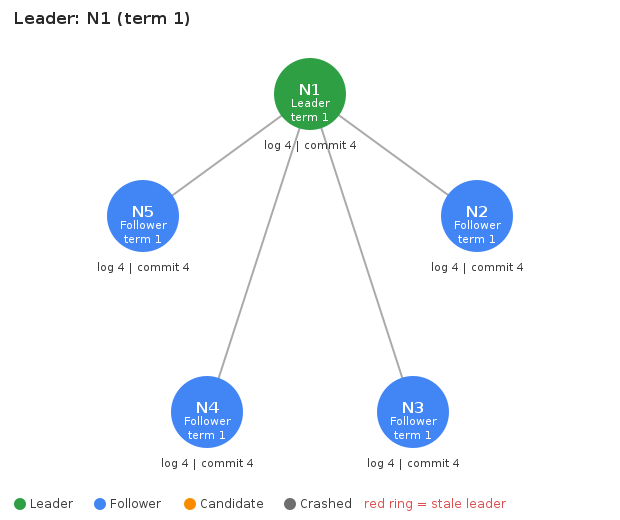
  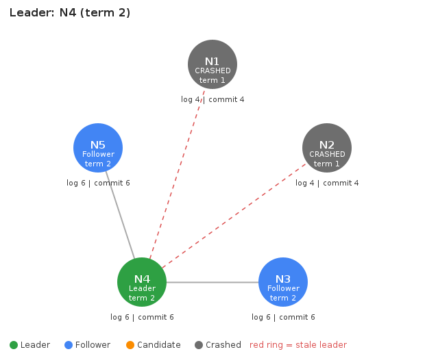
</p>
<p align="center"><em>Cluster view of the dashboard. Left: healthy cluster (N1 is leader). Right: N1 and N2 crashed, N4 was elected leader of term 2 and the dashed red lines show unreachable nodes.</em></p>

---

## Table of contents

- [Why this project](#why-this-project)
- [Features](#features)
- [System architecture](#system-architecture)
- [Class design](#class-design)
- [Node state machine](#node-state-machine)
- [How it works](#how-it-works)
  - [Node thread loop](#node-thread-loop)
  - [Leader election](#leader-election)
  - [Log replication and commit](#log-replication-and-commit)
  - [Follower log-matching decision](#follower-log-matching-decision)
  - [Crash and recovery](#crash-and-recovery)
  - [Network partition scenario](#network-partition-scenario)
- [Simulated network](#simulated-network)
- [Persistence layer](#persistence-layer)
- [Threading and synchronization model](#threading-and-synchronization-model)
- [Requirements](#requirements)
- [Quick start](#quick-start)
- [Command line options](#command-line-options)
- [Using the GUI](#using-the-gui)
- [Console commands](#console-commands)
- [Scripted demo](#scripted-demo)
- [Testing](#testing)
- [Configuration](#configuration)
- [Project layout](#project-layout)
- [Syllabus mapping](#syllabus-mapping)
- [Design decisions and limitations](#design-decisions-and-limitations)
- [Future work](#future-work)
- [Upload to GitHub](#upload-to-github)
- [Author](#author)

---

## Why this project

Consensus is how a group of computers agrees on one value even when some of them crash or the network breaks. It is the foundation of systems such as **etcd** (which powers Kubernetes), **Consul** and many distributed databases. Raft is a consensus algorithm designed to be understandable. This project re-implements its core ideas from scratch so the behaviour can be **seen, controlled and tested**:

> *Break the leader. Cut the network in half. Drop 30% of the messages. The cluster still agrees on one history.*

## Features

| Area | What is implemented |
|---|---|
| **Leader election** | Randomized election timeouts, terms, one vote per term, majority voting, log up-to-date check |
| **Log replication** | `AppendEntries` with consistency check, conflict repair, batching, commit on majority, no-op entry for new leaders |
| **Consensus** | Every node applies committed commands, in order, to a key-value state machine |
| **Fault tolerance** | Crash and recover any node, crash the leader, no-quorum handling |
| **Network faults** | Partitions (any grouping), random message loss, random delay, message tracing |
| **Persistence** | Term, vote and log saved through `Storage` (SQLite via JDBC, plain files, or memory) and reloaded on recovery |
| **Interfaces** | Swing dashboard, interactive console, scripted `--demo` |
| **Quality** | 8 test scenarios (34 checks) plus a live "never two leaders in one term" safety sampler, GitHub Actions CI |

## System architecture

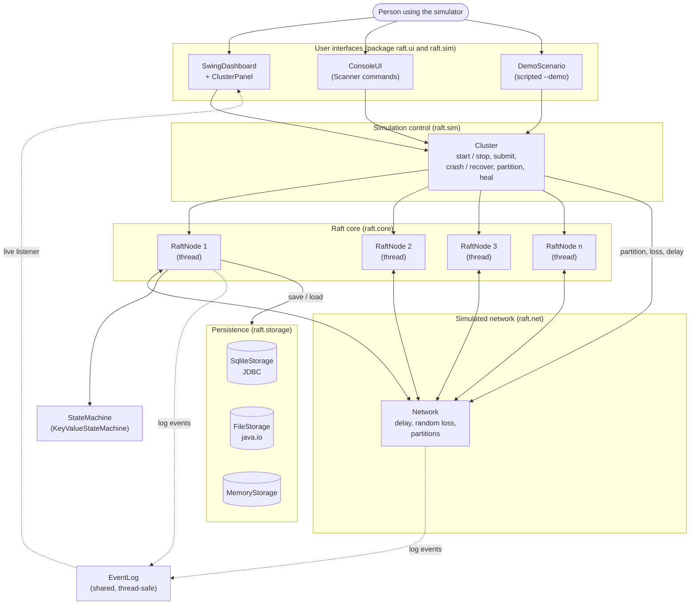

**Reading the diagram:** a person talks to one of three interfaces. They all use the single `Cluster` class, which owns the node threads and the network. Nodes never call each other directly: every message goes through `Network`, so faults can be injected in exactly one place. Each node writes its important state to a `Storage` back-end and applies committed commands to its own `StateMachine`.

## Class design

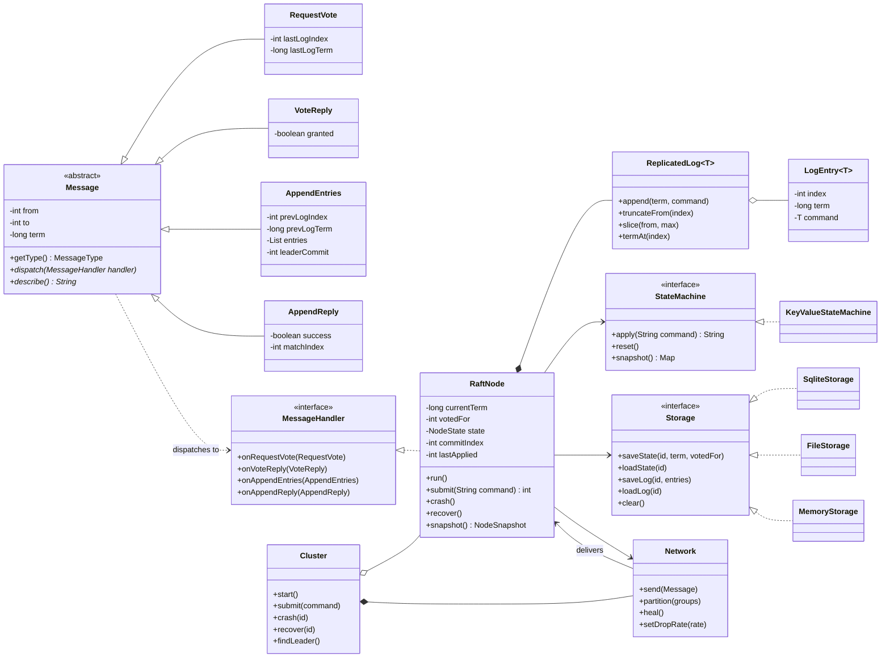

Key object-oriented ideas: `Message` is an **abstract class** with four subclasses and uses **double dispatch** (`message.dispatch(node)` calls the right `onXxx` method, so the node needs no `if/else` on message types). `StateMachine`, `Storage` and `MessageHandler` are **interfaces** with interchangeable implementations. `LogEntry<T>` and `ReplicatedLog<T>` are **generic classes**.

## Node state machine

Every node is always in exactly one of three roles.

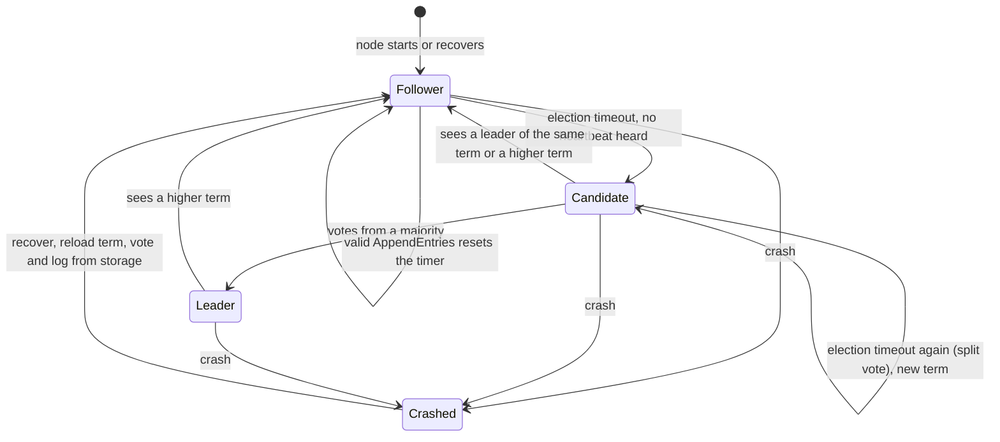

## How it works

### Node thread loop

Each `RaftNode` is a `Runnable` running in its own thread. The loop is tiny, and everything interesting happens in the handlers.

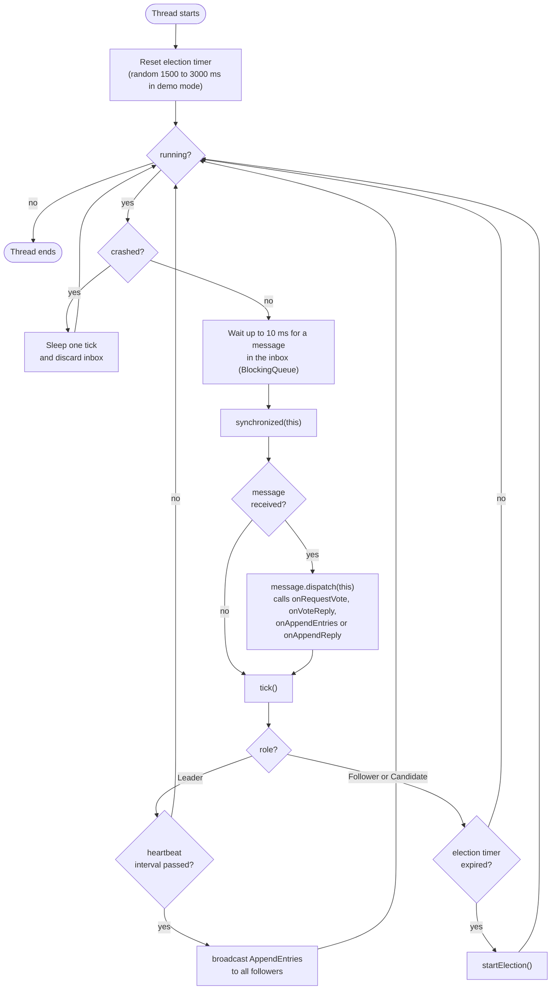

### Leader election

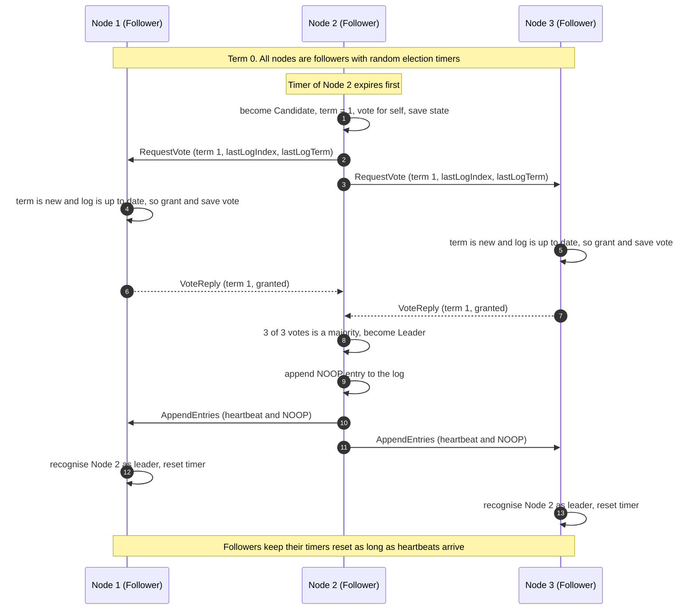

**Rules a node follows when asked for a vote** (`RaftNode.onRequestVote`):

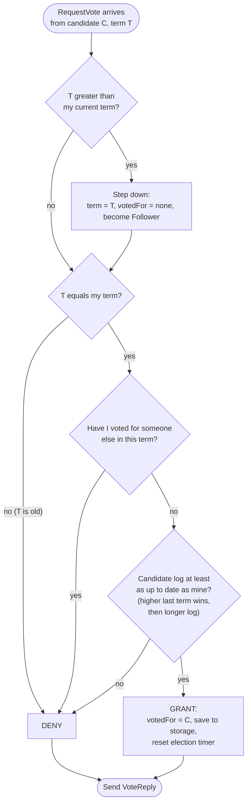

> **Why random timeouts?** If every node timed out at the same moment they would all become candidates and split the votes forever. Randomization makes it very likely that one node times out first, collects a majority and sends heartbeats before the others even wake up.

### Log replication and commit

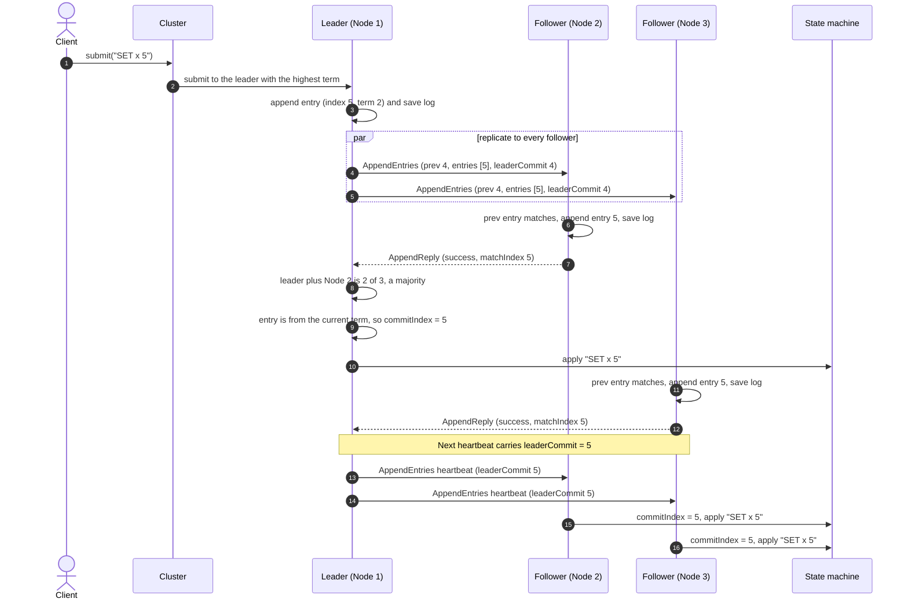

An entry is **committed** once it is stored on a **majority** of nodes *and* belongs to the leader's current term. Committed entries are never lost, even if the leader crashes right afterwards, because any future leader must have them (see the vote rule above).

### Follower log-matching decision

This is the heart of Raft's safety: a follower only appends if its log agrees with the leader's at the previous index, otherwise the leader walks backwards until they agree. It is implemented in `RaftNode.onAppendEntries`.

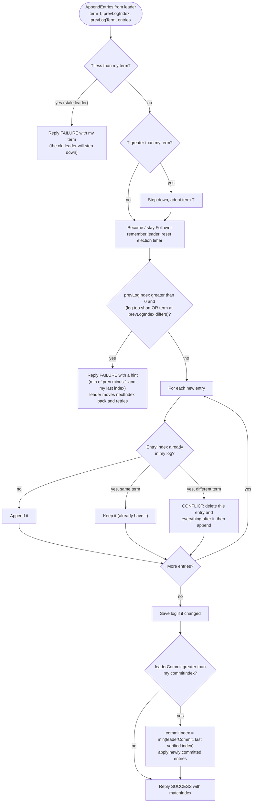

### Crash and recovery

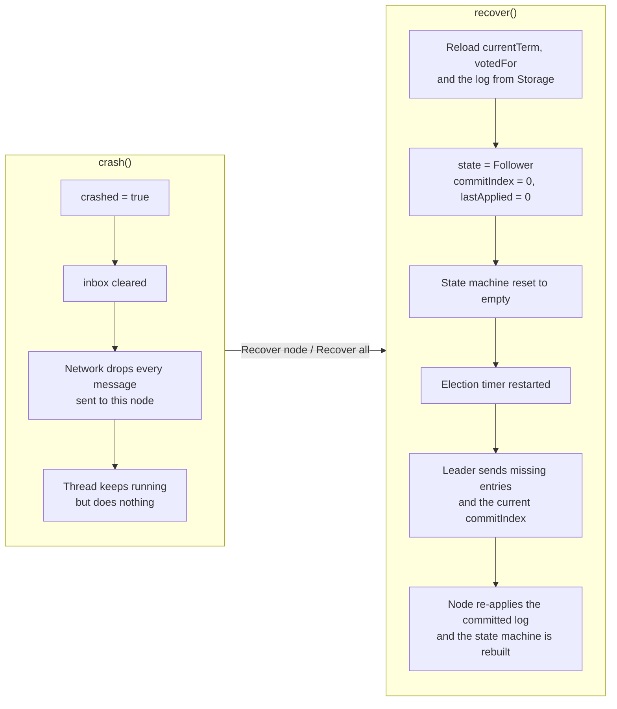

What survives a crash and what does not:

| Survives (saved in storage) | Lost (rebuilt after restart) |
|---|---|
| `currentTerm` | role (always restarts as Follower) |
| `votedFor` (prevents voting twice in a term) | `commitIndex`, `lastApplied` |
| the complete log | state machine contents (rebuilt by replaying the log) |
| | leader-only data (`nextIndex`, `matchIndex`) |

### Network partition scenario

This is exactly what `STEP 5` and `STEP 6` of the [scripted demo](#scripted-demo) do with five nodes: the old leader N5 and N1 are cut off from N2, N3, N4.

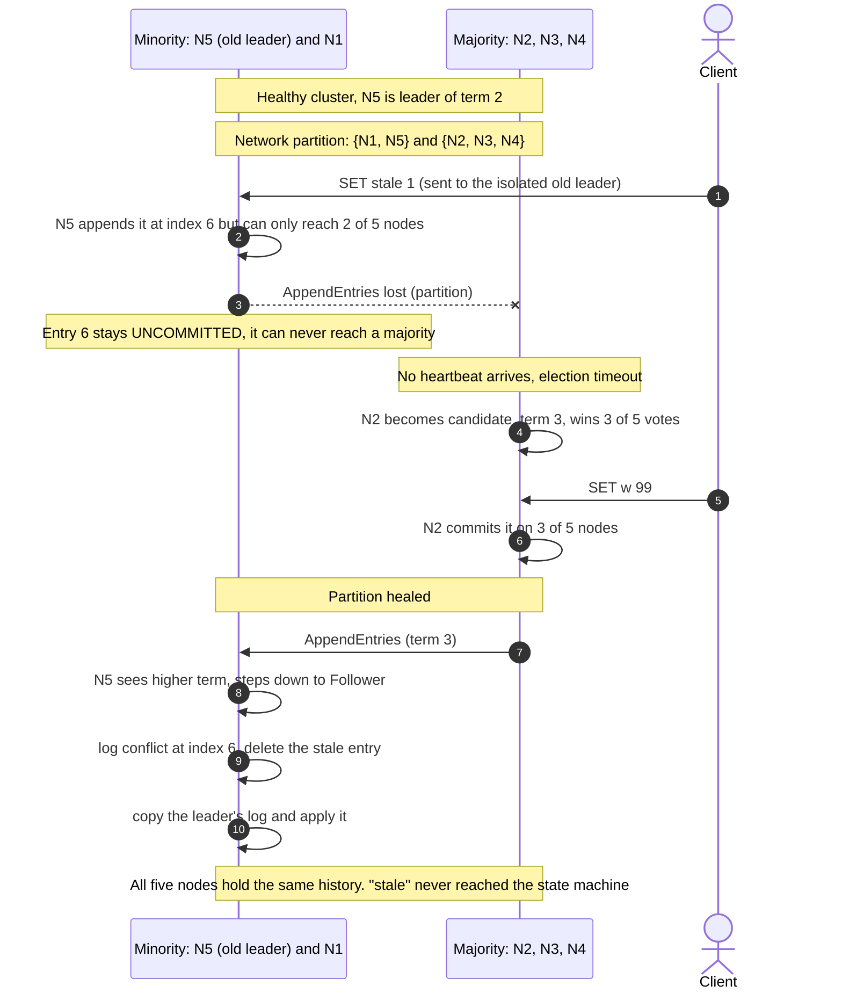

## Simulated network

All traffic goes through `Network`, so faults are injected in exactly one place and nodes cannot "cheat" by calling each other directly.

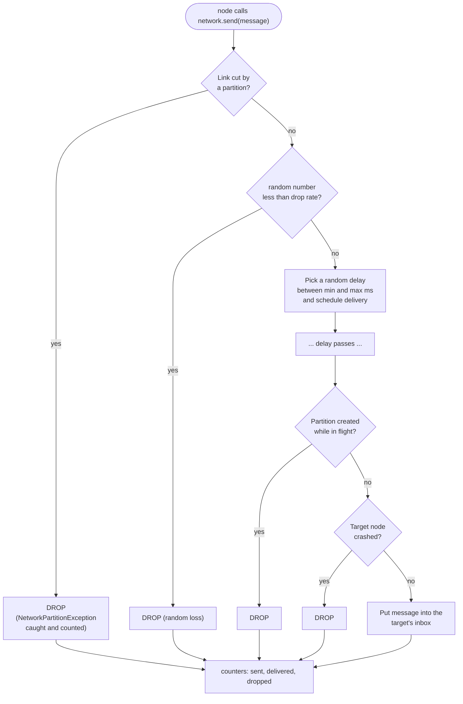

| Message | Sent by | Purpose | Key fields |
|---|---|---|---|
| `RequestVote` | candidate | ask for a vote | term, lastLogIndex, lastLogTerm |
| `VoteReply` | any node | grant or deny | term, granted |
| `AppendEntries` | leader | heartbeat (no entries) or replication | term, prevLogIndex, prevLogTerm, entries, leaderCommit |
| `AppendReply` | follower | accept or reject entries | term, success, matchIndex (or retry hint) |

## Persistence layer

Raft requires `currentTerm`, `votedFor` and the log to survive crashes, otherwise a restarted node could vote twice in one term and break safety. The `Storage` interface has three interchangeable implementations.

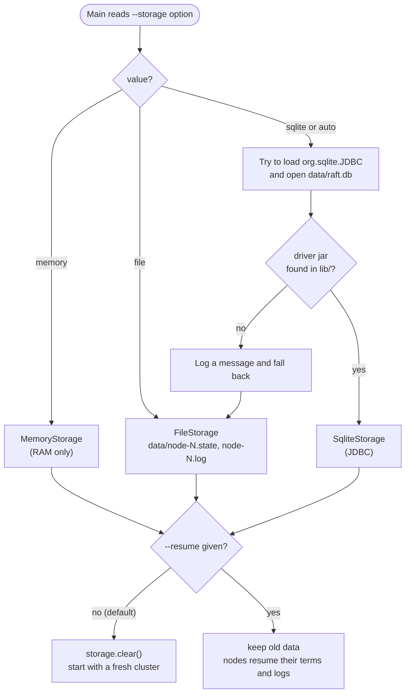

**SQLite schema** (created automatically by `SqliteStorage`):

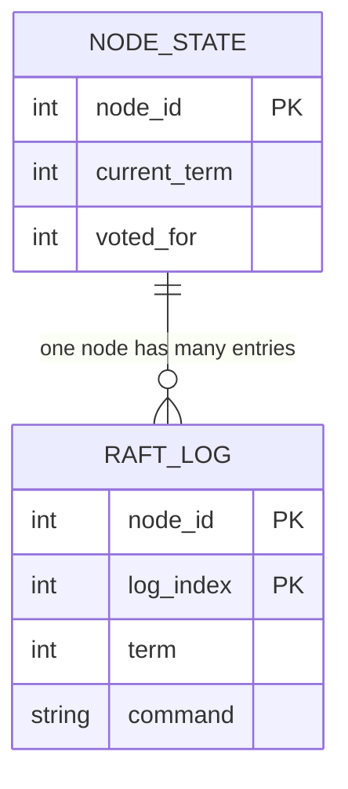

CRUD operations used: `CREATE TABLE` + `INSERT` (create), `SELECT` (retrieve), `UPDATE` (term and vote changes), `DELETE` (clear, log rewrite). Log writes run in a **transaction** with `rollback` on failure and a `finally` block that restores auto-commit.

## Threading and synchronization model

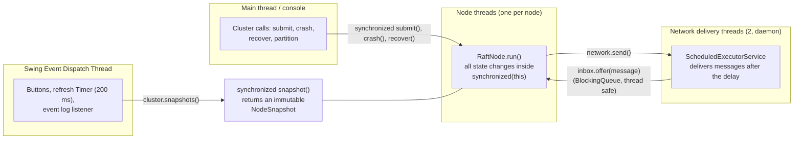

* **Inbox**: a `LinkedBlockingQueue`, so network threads can hand over messages safely.
* **State**: every method that reads or writes term, vote, log or role is `synchronized`, so the node thread, client calls and UI never see half-updated data.
* **UI isolation**: the GUI and tests never touch live nodes. They read an immutable `NodeSnapshot`.
* **Live events**: `EventLog` is thread-safe; the GUI registers a listener and hops onto the Swing thread with `SwingUtilities.invokeLater`.

## Requirements

* **JDK 17 or newer** (check with `javac -version`). Nothing else is needed to compile and run.
* *Optional:* the `sqlite-jdbc` jar in `lib/` to use the database back-end (see `lib/README.txt`). Without it, the program saves to plain files automatically.
* A graphical desktop for the GUI. On a machine without one the program starts in console mode.

## Quick start

```bash
git clone https://github.com/shivansh07adi-cloud/raft-lite.git
cd raft-lite

./build.sh          # compile into ./out
./run.sh            # open the GUI dashboard
./run.sh --cli      # interactive console
./run.sh --demo     # automatic walk-through of every feature
./run-tests.sh      # automated test suite
```

On Windows use `build.bat`, `run.bat` and `run-tests.bat`. Without scripts:

```bash
mkdir out
javac -d out $(find src test -name "*.java")
java -cp "out:lib/*" raft.Main        # Windows: java -cp "out;lib\*" raft.Main
```

## Command line options

| Option | Meaning |
|---|---|
| `--nodes N` | number of nodes, 1 to 9 (default 5) |
| `--gui` / `--cli` / `--demo` | choose the interface (default: GUI if a screen exists, otherwise CLI) |
| `--storage auto\|sqlite\|file\|memory` | persistence back-end (default `auto`: SQLite if the jar exists, else files) |
| `--data DIR` | folder for saved data (default `data`) |
| `--resume` | keep data from a previous run instead of starting fresh |
| `--fast` | very short timeouts (used by tests and CI) |

## Using the GUI

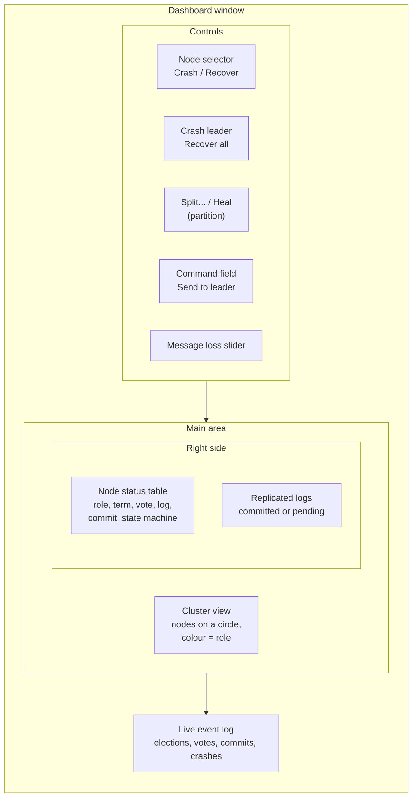

| Colour in the cluster view | Meaning |
|---|---|
| Green | Leader |
| Blue | Follower |
| Orange | Candidate |
| Grey | Crashed |
| Red ring | **Stale leader**: still believes it leads, but a newer term exists |
| Dashed red line | Leader cannot reach this node (crashed or on the other side of a partition) |

**Things to try**

1. Start the GUI and wait 2 to 3 seconds. A leader appears and the others become followers.
2. Type `SET x 5` and press Enter. Watch the commit index rise on every node and `x=5` appear in each state machine.
3. Press **Crash leader**. After an election timeout a new leader is elected with a **higher term**.
4. Press **Recover all**. The old leader returns as a follower and catches up its log.
5. Press **Split...** and enter `1,2|3,4,5`. Send commands, then **Heal** and compare the logs.
6. Move the **message loss** slider to 30% and keep sending commands.

## Console commands

| Command | Action |
|---|---|
| `status` | table of every node: role, term, vote, leader, log size, commit, applied, state machine |
| `logs` | full log of every node, marked committed or pending |
| `send <cmd>` | client command to the leader: `SET x 5`, `x=5`, `DEL x` |
| `crash <id\|leader>` | crash a node or the current leader |
| `recover <id\|all>` | restart crashed nodes |
| `partition 1,2\|3,4,5` | split the network into groups |
| `heal` | repair the network |
| `drop <percent>` | random message loss, for example `drop 20` |
| `delay <min> <max>` | network delay range in milliseconds |
| `trace on\|off` | print every message sent |
| `help`, `quit` | |

## Scripted demo

`./run.sh --demo` runs a complete scenario and checks the result at each step. It is ideal for a presentation.

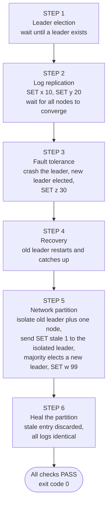

Sample output (abridged; terms and node numbers vary from run to run):

```text
STEP 3: Fault tolerance - crash the leader, a new one is elected
[18:30:33.050] N3 *** CRASHED *** (was Leader, term 1)
[18:30:33.183] N5 election timeout -> CANDIDATE for term 2
[18:30:33.196] N5 won the election -> LEADER of term 2 (votes: 1,4,5)
   [PASS] new leader elected
   [PASS] new leader is a different node

Node  Role       Term  Voted  Leader  Log   Commit  Applied  State machine
N1    Follower   2     N5     N5      5     5       5        {x=10, y=20, z=30}
N2    Follower   2     N5     N5      5     5       5        {x=10, y=20, z=30}
N3    CRASHED    1     N3     N3      3     3       3        {x=10, y=20}
N4    Follower   2     N5     N5      5     5       5        {x=10, y=20, z=30}
N5    Leader     2     N5     N5      5     5       5        {x=10, y=20, z=30}

STEP 6: Heal the partition - the stale entry is discarded
[18:30:35.135] N5 log conflict at index 6 -> deleting entries from 6 onwards
   [PASS] cluster converged again
   [PASS] stale command never reached the state machine
```

## Testing

`./run-tests.sh` runs eight scenarios with fast timeouts (about 30 seconds in total). GitHub Actions runs the same suite on every push.

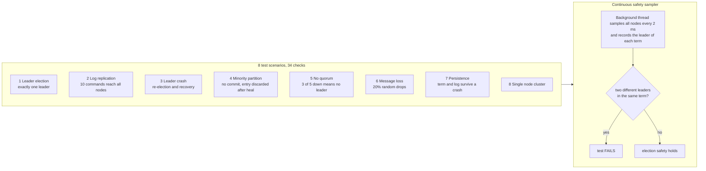

Expected last line:

```text
RESULT: 34 passed, 0 failed
```

## Configuration

All timing lives in `core/RaftConfig.java` (milliseconds).

| Parameter | `demo()` (default GUI/CLI) | `fast()` (tests, `--fast`) |
|---|---|---|
| Election timeout (random range) | 1500 to 3000 | 150 to 300 |
| Heartbeat interval | 500 | 50 |
| Thread tick (inbox wait) | 10 | 5 |
| Network delay (random range) | 40 to 150 | 1 to 8 |
| Max entries per `AppendEntries` | 10 | 10 |

The heartbeat is much shorter than the election timeout, so a healthy leader always resets followers' timers in time. The state machine accepts `SET key value`, `key=value` and `DEL key`.

## Project layout

```text
raft-lite/
├── src/raft
│   ├── Main.java                  <- entry point and command line options
│   ├── core/                      <- the Raft algorithm
│   │   ├── RaftNode.java            one server: election, replication, crash/recovery (thread)
│   │   ├── NodeState.java           FOLLOWER / CANDIDATE / LEADER (enum)
│   │   ├── LogEntry.java            generic log entry <T>
│   │   ├── ReplicatedLog.java       generic log <T> (ArrayList, Iterable)
│   │   ├── StateMachine.java        interface
│   │   ├── KeyValueStateMachine.java
│   │   ├── RaftConfig.java          timing parameters
│   │   └── NodeSnapshot.java        immutable read-only view of a node
│   ├── net/                       <- simulated network and messages
│   │   ├── Message.java             abstract base class
│   │   ├── RequestVote / VoteReply / AppendEntries / AppendReply
│   │   ├── MessageHandler.java      interface implemented by RaftNode
│   │   ├── MessageType.java
│   │   └── Network.java             delay, loss, partitions
│   ├── storage/                   <- persistence
│   │   ├── Storage.java             interface
│   │   ├── SqliteStorage.java       JDBC + SQLite
│   │   ├── FileStorage.java         java.io files
│   │   ├── MemoryStorage.java
│   │   ├── PersistentState.java
│   │   └── StorageFactory.java      picks the back-end
│   ├── sim/
│   │   ├── Cluster.java             creates nodes, failure injection, client interface
│   │   └── DemoScenario.java        scripted demo
│   ├── ui/                        <- ConsoleUI, SwingDashboard, ClusterPanel, StatusFormatter
│   ├── exception/                 <- NodeCrashed, NotLeader, NetworkPartition, Storage exceptions
│   └── util/                      <- EventLog, Util (generic methods)
├── test/raft/RaftTests.java       <- automated tests
├── docs/
│   ├── CODE_WALKTHROUGH.md          reading order, flows, viva questions
│   ├── REPORT_OUTLINE.md            chapter outline for the project report
│   └── images/                      screenshots used in this README
├── lib/                           <- optional sqlite-jdbc jar goes here
├── data/                          <- saved state at runtime (git-ignored)
├── .github/workflows/ci.yml       <- GitHub Actions CI
├── build.sh / build.bat
├── run.sh / run.bat
└── run-tests.sh / run-tests.bat
```

## Syllabus mapping

How the project covers every unit of the Java course:

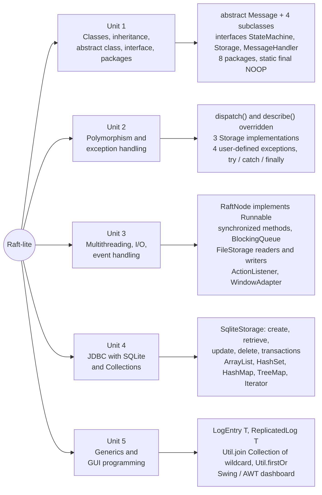

| Unit | Topic | Where it is used |
|---|---|---|
| 1 | Classes, objects, constructors, `static`, `final` | every class; `RaftNode.NOOP` (static final), `RaftConfig` |
| 1 | Inheritance, abstract class, interface, packages | abstract `Message` and 4 subclasses; interfaces `StateMachine`, `Storage`, `MessageHandler`; 8 packages |
| 2 | Compile-time and runtime polymorphism | overloaded constructors; `dispatch()` and `describe()` overridden per message; `Storage` has 3 implementations |
| 2 | Exceptions: try / catch, multiple catch, throw, throws, finally, user-defined | `NodeCrashedException`, `NotLeaderException`, `NetworkPartitionException`, `StorageException`; rollback + `finally` in `SqliteStorage.saveLog` |
| 3 | Threads, `Runnable`, synchronization, inter-thread communication | each `RaftNode` is a thread; `synchronized` methods; `BlockingQueue` inbox |
| 3 | I/O streams | `FileStorage` (`FileReader`, `FileWriter`, `BufferedReader`, `PrintWriter`) |
| 3 | Event handling, delegation model, adapter classes | `SwingDashboard`: `ActionListener`, `WindowAdapter` |
| 4 | JDBC with SQLite: create database and tables, create / update / delete / retrieve | `SqliteStorage` |
| 4 | Collections: List, Set, Map, `ArrayList`, `HashSet`, `HashMap`, `TreeMap`, `Iterator` | log (`ArrayList`), votes (`HashSet`), `nextIndex` / `matchIndex` (`HashMap`), `Iterable` log |
| 5 | Generic classes, generic methods, wildcards | `LogEntry<T>`, `ReplicatedLog<T>`, `Util.join(Collection<?>)`, `Util.firstOr` |
| 5 | GUI programming | Swing / AWT dashboard |

> **Note on the GUI toolkit:** the syllabus lists JavaFX, but JavaFX is not part of the JDK and needs a separate SDK. To keep the project runnable with only a JDK, the dashboard uses **Swing / AWT**, which ships with Java and uses the same event model taught in Unit 3.

## Design decisions and limitations

* **Single JVM, simulated network.** Nodes are threads and messages travel through a scheduler instead of sockets. This keeps the project runnable anywhere and makes fault injection exact and repeatable.
* **No-op entry on election.** A new leader appends `NOOP`, so entries from earlier terms can be committed safely (a leader only commits entries of its own term directly).
* **Randomized timeouts** avoid split votes; heartbeats are much faster than timeouts.
* **Whole-log persistence.** The log is saved as a whole each time it changes. This is simple and correct for a demo but would be replaced by append-only writes in a real system.
* **Not implemented** (outside "Raft-lite"): cluster membership changes, log compaction and snapshots, pre-vote and leader leases. After a partition heals, a briefly isolated node can trigger an extra election because it increased its term while alone. This is normal in Raft without pre-vote.

## Future work

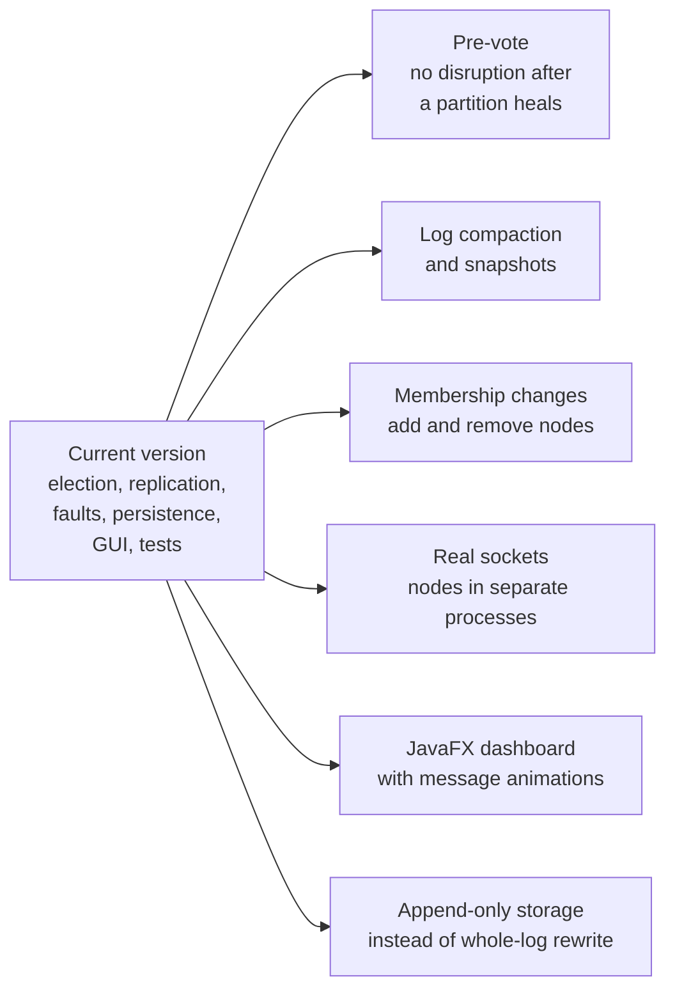

## Upload to GitHub

```bash
cd raft-lite
git init
git add .
git commit -m "Distributed Consensus Simulator (Raft-lite)"
git branch -M main
git remote add origin https://github.com/shivansh07adi-cloud/raft-lite.git
git push -u origin main
```

Or create an empty repository on github.com and use **Add file > Upload files** to drag in the unzipped folder contents.

## Author

**Shivansh Kumar** | AP25110010113 | Section E, 2nd Year, 3rd Semester | SRM University AP
Portfolio: [shivanshonline.in](https://shivanshonline.in)
